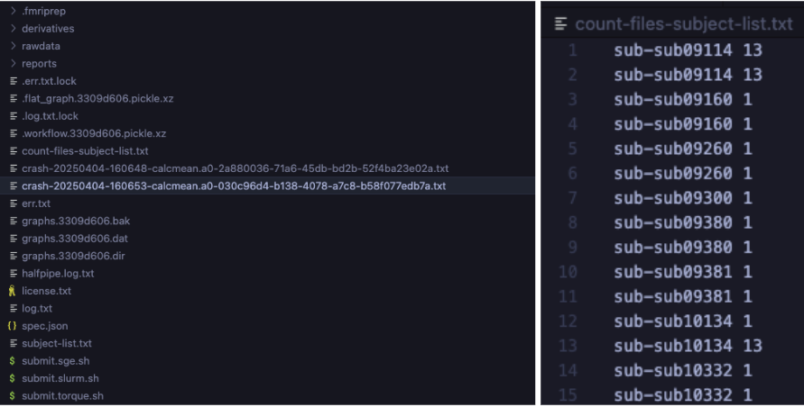
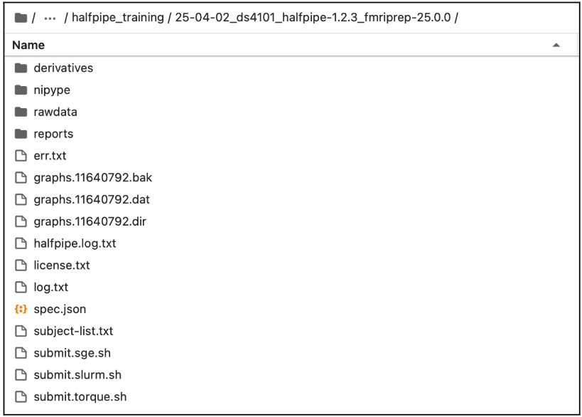
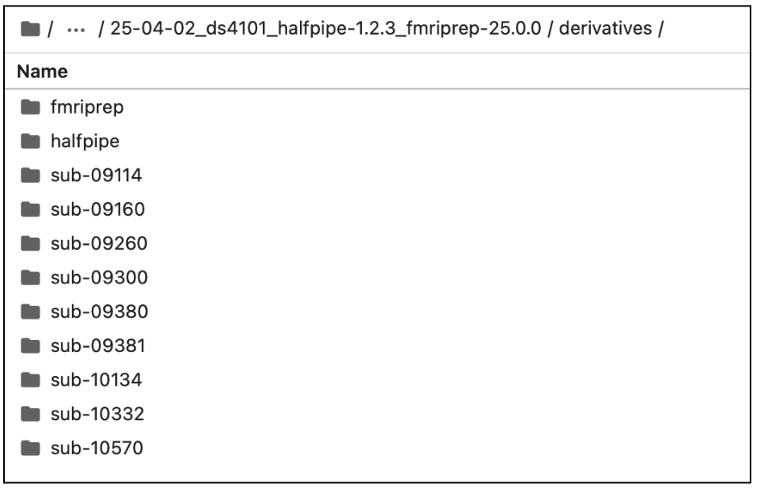

::: {.author-text}
<span style="color: #808080;">AUTHOR</span>

Written by Clara El Khantour, Lea Waller, Seann Wang, Pierre Lune Bellec, Frank Hillary, Ilya Veer, Clara Moreau

Please address questions and comments to [halfpipe@fmri.science](halfpipe@fmri.science). You can also join the HALFpipe Mattermost (similar to Slack) using this [link](https://mattermost.fmri.science/signup_user_complete/?id=hcc766b7wjdazexwe799hbsuwc&md=link&sbr=su).
:::

# **1\. Run the pipeline** {#1.-run-the-pipeline}

::: {.panel-tabset}

## **1.1 On a High-performing cluster (HPC)** 

1. Navigate to your working directory in terminal: 

```bash
cd path/to/your_working_space/your_enigma_directory/your_working_dir
```

2. Let’s visualize the files that have been created with ls   
   1. Check for the files and folders: **derivatives, nipype, rawdata, reports, submit.slurm.sh, work, workflow\*\*\*.pickle.xz, execgraph\*\*\*.pickle.xz.**   
   2. If these files are created, continue to step 3, if not, please have a look at the error file and the troubleshooting page.

3. Open the generated `submit.slurm.sh` file and compare it with the example below.

   1. Make sure that the path associated with the flag  \--bind is the same as the one you used to launch the pipeline (see [Launch HALFpipe on a cluster](manual_old_ui.qmd#launch-on-hpc)).
   2. Verify all the paths, make sure that they are all correct.  
   3. If necessary   
      1. You can edit the \#bin bash command (e.g. add \#SBATCH \--account=def-account in **submit.slurm.sh**).   
      2. If you are unsure, please refer to your HPC’s documentation or contact your IT support.  

::: {.callout-note collapse="false"}

Depending on your cluster’s configuration (e.g., SGE or Torque), these modifications may need to be applied to a different submit file than the SLURM example provided. Please consult your cluster’s documentation or contact your IT support team to confirm.*

:::

Here is an example of a submit.slurm.sh file generated by HALFpipe:

```bash
#!/bin/bash

#SBATCH --job-name=halfpipe  
#SBATCH --output=halfpipe.log.txt  
#SBATCH --time=05:00:00

#SBATCH --ntasks=1  
#SBATCH --cpus-per-task=2  
#SBATCH --mem=10752M

#SBATCH --array=1-9

if ! [ -x "$(command -v singularity)" ]; then  
  module load singularity  
fi

singularity run \
  --contain --cleanenv \
  --bind /home/username \
  /home/username/projects/containers/halfpipe-1.2.3.sif \
  --workdir /home/username/projects/working_directory \
  --only-run \
  --uuid 3309d606 \
  --subject-list /home/username/projects/working_directory/subject-list.txt \
  --subject-chunks \
  --only-chunk-index ${SLURM_ARRAY_TASK_ID} \
  --nipype-n-procs 2 \
  --keep some
```

4. To reduce the number of files and the amount of disk space used, please update the submit.slurm file as shown below.  
* Look for lines marked with **modification \====\>**, which indicates where you need to add a line and update it with your own path.   
* Lines marked with **copy-paste \====\>** can be added as-is, without any changes.   
* Ensure that the unchanged lines match those in your original document (e.g., uuid, path to access your HalfPipe container, etc.).  
  You can copy and paste the following lines into your script, making sure to adjust the paths accordingly:

Example of a submit.slurm.sh file modified to reduce number of file produced and disk usage:

<table style="width:100%; border-collapse:collapse">
  <tr>
    <td style="vertical-align: top; width: 18%; padding-right: 0.5em; line-height: 0.4;">
      <br><br><br><br><br><br><br><br><br><b><br><br><br><br><br><br><br><br><br><br><br><br><br><br><br><br><br><br><br><br><br><br><br><br><br><br><br><br><br><br><br><br><br><br><br><br><br><br><br><br>
      <strong>modification =></strong><br><br><br>
      <strong>copy-paste ==></strong><br><br><br><br><br><br><br><br><br><br><br><br><br><br><br><br><br>
      <strong>copy-paste ==></strong><br><br><br><br><br><br>
      <strong>copy-paste ==></strong><br><br><br><br><br><br><br><br><br><br>
      <strong>copy-paste ==></strong><br><br><br><br><br><br><br><br><br><br><br><br><br>
      <strong>modification =></strong>
    </td>
    <td style="vertical-align: top; width: 83%;">

```bash
#!/bin/bash

#SBATCH --job-name=halfpipe
#SBATCH --output=halfpipe.log.txt
#SBATCH --time=05:00:00
#SBATCH --ntasks=1
#SBATCH --cpus-per-task=2
#SBATCH --mem=10752M
#SBATCH --array=1-9

if ! [ -x "$(command -v singularity)" ]; then
  module load singularity
fi

working_directory="/home/username/projects/working_directory"
nipype_directory="$(mktemp -d)"

singularity run \
  --contain --cleanenv \
  --bind /home/username \
  --bind "${nipype_directory}:${working_directory}/nipype" \
  /home/username/projects/containers/halfpipe-1.2.3.sif \
  --workdir "${working_directory}" \
  --only-run \
  --uuid 3309d606 \
  --subject-list "${working_directory}/subject-list.txt" \
  --subject-chunks \
  --only-chunk-index ${SLURM_ARRAY_TASK_ID} \
  --nipype-n-procs 2 \
  --keep none
```

   </td>
</tr> 
</table> 


5. Now run the pipeline by submitting the submit.slurm script that has been created in the pipeline folder. 

<table class="bordered">
  <tr>
    <td><strong>SLURM</strong></td>
    <td>

```bash
sbatch submit.slurm.sh
```

   </td>
  </tr>
  <tr>
    <td><strong>SGE</strong></td>
    <td>

```bash
qsub submit.sge.sh
```

   </td>
  </tr>
  <tr>
    <td><strong>Torque/PBS</strong></td>
    <td>

```bash
qsub submit.torque.sh
```

   </td>
  </tr>
</table>


After the jobs finish, [check the preprocessing outputs](#check-preprocessing-outputs) before starting [4. Quality control](quality-control.qmd).

---

## **1.2 On a Local Machine** 

If you are running this on a local computer, the pipeline will have started. Once it has finished, [check the preprocessing outputs](#check-preprocessing-outputs).

:::

# **2\. Check pre-processing and re-run if necessary** 

::: {.callout-warning collapse="false"}

In some cases, you will need to ensure the code is compatible with your setup (not just copy and paste), especially regarding the container bindings (**[see the section 4 of the troubleshooting page](troubleshooting.qmd#your-script-keep-crashing-after-few-moments-it-could-be-caused-by-an-environment-errors-in-hpc)**). The text highlighted in <span style="background-color:rgb(255, 204, 204);">red</span> requires your attention.

:::

<span id="check-preprocessing-outputs"></span>

Check that the expected outputs are present, then rerun any incomplete subjects before visual QC.

1. **Open a terminal session.**

2. **Navigate to your working directory: cd path/to/your\_working\_dir**

3. **Copy and paste the whole block of code into your terminal session. Then hit enter.**

```bash
find "derivatives/halfpipe" -type d -path "*/func" | while read task_dir; do  
  sub_id=$(echo "$task_dir" | grep -o "sub-[^/]*")  
  file_count=$(find "$task_dir" -type f | wc -l)  
  echo "$sub_id $file_count"  
done | sort > count-files-subject-list.txt  

echo "Done. See count-files-subject-list.txt for subject file counts."
```

4. **Check the Generated Files**

The command writes `count-files-subject-list.txt` in your working directory. It lists one count per `func` directory. A subject with multiple sessions can appear on multiple rows, and a subject without a `func` directory will be absent. Use the [summary report](qc/before-starting.qmd#step-1-open-the-summary-report-in-the-reports-folder) to check for missing outputs.

---

5. **Check for Errors**

Use `ls` to view the contents of your working directory.

If crash files are present, inspect `err.txt` and see [Troubleshooting](troubleshooting.qmd) for guidance. Continue to the output check below whether or not you found crash files.

---

6. **Validate and Interpret the Output**

**a.** Open `count-files-subject-list.txt` and check whether the counts match the runs and sessions you expected to process.

**b.** If some subjects have fewer files than expected:
- Open `err.txt` to check for errors.

::: {.callout-warning collapse="false"}
Subjects may legitimately have fewer files (e.g., fewer runs or sessions).  
_Cross-check with your original dataset before considering a re-run._
:::

If the expected outputs are present, continue to [4. Quality control](quality-control.qmd). If outputs are incomplete, [rerun the affected subjects](#rerun-halfpipe).




**Left**: Example of crash files corresponding to processing errors.  
**Right**: Count-files-subject-list.txt output showing inconsistent file counts per subject; 

<span id="rerun-halfpipe"></span>

7. **Rerun HALFpipe**
   1. In your working directory, create or update `incomplete-subject-list.txt` with the IDs of the subjects you want to reprocess, one per line. Use the same format for subjects you choose to rerun after visual QC.
   2. Run HALFpipe again with the same command as in [Launch HALFpipe](manual_old_ui.qmd#launching-the-pipeline), but add the option \--subject-list \<path/to/**incomplete-subject-list.txt**\> to the end of the command. Then select Run without modification.

For example:

::: {.panel-tabset}

## Apptainer

<pre style="background-color:#f7f7f7; padding:10px; border-radius:4px;"><code class="language-bash">
apptainer run \
  --contain \
  --cleanenv \
  --bind <span style="background-color:rgb(255, 204, 204);">/:/ext</span> \
  halfpipe-1.2.3.sif \
  --subject-chunks \
  --nipype-n-procs 1 \
  --keep none \
  --subject-list path/to/incomplete-subject-list.txt
</code></pre>

## Docker

::: {.callout-warning collapse="false" title="If you have a large dataset"}
Do not forget to adapt your number of CPUs
:::

Use the same image and volume mounts as your original Docker command. Pass the subject-list path as seen inside the container. For example, with the host root mounted at `/ext`:

```bash
docker run --interactive --tty --volume /:/ext \
  halfpipe/halfpipe:1.3.1 \
  --subject-chunks --nipype-n-procs 1 --keep none \
  --subject-list /ext/path/to/your_working_dir/incomplete-subject-list.txt
```

:::


8. **Only if running on a HPC**:  
* Submit again the job following instruction in **Section 1.1.**  
* After the jobs have finished, rerun the steps in the section until no incomplete subjects remain. 

*Content of the output*

Example of the working directory generated by HALFpipe after completing **one of the fMRI Manual**:



Example of the derivative folder generated by HALFpipe after completing **Section 1**:



# What's next?

Once the pipeline finishes and the expected outputs are present, continue to [4. Quality control](quality-control.qmd) to assess whether the images are usable.

If you encounter any problems, please check the **[7. Troubleshooting](troubleshooting.qmd)**.

:::{.footnotes}
_Manual adapted from the **MDD ENIGMA resting-state fMRI manual** and the **OCD ENIGMA task-based fMRI manual**._
:::
