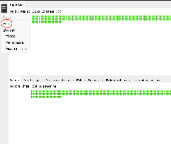

::: {.author-text}
<span style="color: #808080;">AUTHOR</span>

Adapted by Clara El Khantour from the original TaskBasedfMRI Genetics Manual by Lea Waller, Susanne Erk, and Gina-Isabelle Henze.

Reviewed and tested by Pierre Bergeret and Mathieu Dugré.
:::

::: {.callout-note title="Work in progress"}
This group-level analysis guide is being revised.
:::

[Prerequisites](#prerequisites)

[Data preprocessing, feature extraction and Quality Control](#data-preprocessing-feature-extraction-and-quality-control)

[Get your QC report](#get-your-qc-report)

[Download the latest version of HALFpipe](#download-the-latest-version-of-halfpipe)

[Identify your paths](#identify-your-paths)

[HALFpipe derivatives](#halfpipe-derivatives)

[Spreadsheet with covariates](#spreadsheet-with-covariates)

[Select features of interest](#select-features-of-interest)

[Run group-level analysis](#run-group-level-analysis)

[Send your group-level folder](#send-your-group-level-folder)

# **Prerequisites** {#prerequisites}

## Data preprocessing, feature extraction and Quality Control {#data-preprocessing-feature-extraction-and-quality-control}

This manual assumes that you have already run HALFpipe for the preprocessing, feature extraction, and QC. If you are still preparing your inputs, see [2. Configure resting-state analysis](configure.qmd), [3. Run and check outputs](check_run.qmd), and [4. Quality control](quality-control.qmd). To save your ratings, follow [4.4 Export ratings and rerun if needed](qc/rerun.qmd#export-your-qc-ratings).

After completing the preprocessing and feature extraction, we are now ready to perform group-level analysis. To do so, we will need to download a more recent version of HALFpipe. 

**→ Important: You will not need to re-run processing and QC**; we will proceed directly to group-level analysis using your existing outputs. 

Below is an example of the structure of your working directory created with HALFpipe following preprocessing and QC:

```text
Working_directory/
│
├── derivatives/
│   └── halfpipe/
│       └── sub-01/
│           └── [HALFpipe derivatives]
│
└── reports/
    └── exclude.json   # QC report / list of excluded subjects or runs
```

## Get your QC report {#get-your-qc-report}

Once you are done with the QC, you can export your rating into a JSON file (if not done yet). You will need this file for the group-level analysis in order to exclude subjects with bad images. 

To export the exclusion file, simply return to the index.html page (your ratings should have been saved automatically). From there, open the menu (top left), select Export, and the file will be downloaded. Here is where you can find this export button.

  
→ You should copy-paste the path where this file is located. We will use it in the command line later.

## Download the latest version of HALFpipe {#download-the-latest-version-of-halfpipe}

::: {.table-responsive}

| Container | Instructions |
| :---- | :---- |
| Docker Desktop |  `docker pull --platform linux/amd64 halfpipe/halfpipe:latest` |
| Singularity (3.x) or Apptainer | `curl -O https://download.fmri.science/singularity/halfpipe-latest.sif` |

:::

# **Identify your paths** {#identify-your-paths}

## HALFpipe derivatives {#halfpipe-derivatives}

Please find the folder where the outputs from HALFpipe were generated and copy-paste the path somewhere, we will use it later. The required folder is under **work\_dir/derivatives/halfpipe**

## Spreadsheet with covariates {#spreadsheet-with-covariates}

- Your spreadsheet should contain the following columns.  
  - id containing the same subject IDs as in the image file names   
  - age in years  
  - sex coded as “male” and “female”  
  - diagnosis coded as “anorexia” or “control”  
  - site and scanner only if applicable, coded either numerically or as text  
- **If your data are coded differently**, then you may need to adapt the command line flags when specifying your data (as described in the section [Run group-level analysis](#run-group-level-analysis)).  
- For example, your spreadsheet could look like this.

::: {.table-responsive}

|  | id | age | sex | diagnosis | scanner |
| :---- | :---- | :---- | :---- | :---- | :---- |
|  | 01 | 28 | female | anorexia | scanner1 |
|  | 02 | 25 | male | control | scanner2 |

:::

In our analysis, we will include these variables as **mandatory covariates**: 

- `Continuous variable: age`  
- `Categorical variables: sex and diagnosis (and site/scanner if relevant)` 

# **Select features of interest** {#select-features-of-interest}

**Create a text file named feature-list.txt**. This file specifies which features the group-level analysis will run on: Seed-based and Atlas-based. This file contains the feature names you specified when running HALFpipe. Make sure the names match what you provided; if not, edit the file accordingly. 

You can find the feature names in the derivatives filename: sub-01\_ses-01\_task-rest\_**feature-CorrMatrix1**\_ …

What feature-list.txt contains:

```text
corrMatrix1
corrMatrix2
corrMatrix3
corrMatrix4
corrMatrix5
seedCorr1
seedCorr2
seedCorr3
seedCorr4
seedCorr5
```

# **Run group-level analysis** {#run-group-level-analysis}

We are now ready to run HALFpipe for the group-level analysis. 

* **For HPC users:** We recommend submitting a job on your cluster, the same way you did for the preprocessing. To do this:

  1. Create a new executable file named submit-grouplevel.**slurm**.sh if using Slurm (or submit-grouplevel.**sge**.sh for SGE, submit-grouplevel.**torque**.sh for Torque, depending on your server) 

  2. Replicate the configuration you had at the top of your submit.slurm.sh file that you used to run the preprocessing (adjusting resource allocations, if necessary). 

     **Note**: As we are performing group-level analysis, you do not need to run each subject in parallel, so make sure to remove the following parameter from your configuration: 

- For slurm, remove: `#SBATCH --array=1-9`  
- For SGE, remove: `#$ -t 1-234`  
- For Torque, remove: `#PBS -J 1-234`  
  Here is an example of a `submit-grouplevel.slurm.sh` script:

```bash
#!/bin/bash
#SBATCH --job-name=halfpipe-group
#SBATCH --output=halfpipe-group.log.txt
#SBATCH --time=12:00:00
#SBATCH --ntasks=1
#SBATCH --cpus-per-task=2
#SBATCH --mem=10752M

if ! [ -x "$(command -v singularity)" ]; then
    module load singularity
fi

singularity run \
  --contain --bind /mnt --bind /tmp \
  /mnt/containers/halfpipe-latest.sif \
  --num-threads 16 \
  group-level \
  …
```

  3. Execute the file using the appropriate command.

::: {.table-responsive}

| SLURM | `sbatch submit-grouplevel.slurm.sh` |
| :---- | :---- |
| **SGE** | `qsub submit-grouplevel.sge.sh` |
| **Torque/PBS** | `qsub submit-grouplevel.torque.sh` |

:::

* **On a local computer**: simply copy and paste the command line below in your terminal using Singularity (Apptainer) or Docker, depending on your system. You will have to adjust the paths and variables as described [in the following section](#command-explanations).

Below is an example of what a complete command might look like.   
→ It is important to carefully adapt each part to the specifics of your dataset. In most cases, the parts in **bold** will stay the same as in the example. The parts in *cursive* will definitely need to be adapted for your dataset.

* If you are transferring your working directory to another system for processing, only the derivatives folder is needed.

* **Important:** For categorical variables, order of levels matters. You need to specify the levels in the same sequence as shown here for sex and diagnosis**.** See below for more details.

### Docker Desktop

```bash
docker run \
 --interactive \
  --tty \
 --volume /mnt --volume /tmp \
 halfpipe:latest \
 --num-threads 8 \
 group-level \
 --input-directory \
     /mnt/data/berlin/derivatives/halfpipe \
     /mnt/data/paris/derivatives/halfpipe \
 --qc-exclude-files /mnt/data/halfpipe/exclude.json \
 --fd-mean-cutoff 0.5 \
 --fd-perc-cutoff 10 \
 --output-directory /mnt/data/cwas-output \
 --include-list feature /mnt/feature-list.txt \
 --spreadsheet /mnt/data/participants.tsv \
 --id-column id \
 --continuous-variable age \
 --categorical-variable sex --levels female male \
 --categorical-variable diagnosis --levels controls anorexia \
 --categorical-variable scanner --levels scanner1 scanner2 \
 --imaging-variable fd_mean
```

### Singularity (3.x) or Apptainer

```bash
singularity run \
 --contain --bind /mnt --bind /tmp \
 /mnt/containers/halfpipe-latest.sif \
 --num-threads 16 \
 group-level \
 --input-directory \
     /mnt/data/berlin/derivatives/halfpipe \
     /mnt/data/paris/derivatives/halfpipe \
 --qc-exclude-files /mnt/data/halfpipe/exclude.json \
 --fd-mean-cutoff 0.5 \
 --fd-perc-cutoff 10 \
 --output-directory /mnt/data/cwas-output \
 --include-list feature /mnt/feature-list.txt \
 --spreadsheet /mnt/data/participants.tsv \
 --id-column id \
 --continuous-variable age \
 --categorical-variable sex --levels female male \
 --categorical-variable diagnosis --levels controls anorexia \
 --categorical-variable scanner --levels scanner1 scanner2 \
 --imaging-variable fd_mean
```


[]{#command-explanations}

* Based on this example, we can start building your own command specific to your dataset. First, we need to configure how Singularity will run the HALFpipe container. **This should be the same configuration as the one you used to run HALFpipe initially.**

::: {.table-responsive}

| Command text |  | Explanation |
| :---- | ----- | :---- |
| **singularity (or apptainer) run Or  Docker run (for Docker)** |  | The first part of the command calls Singularity and specifies that we want to run a container. |
| **\--bind Or  \--volume (for Docker)** |  | **You can use the same bind arguments as the ones you used for running HALFpipe initially.** The container can only see your current folder and your home folder. If your data is stored somewhere else (for example, a shortcut in your home folder that points to another disk), the container won't be able to open it. To fix this, tell the container where your data is by adding the `--bind` option with the real location of your data: For example, if your data is stored in /mnt/data/gwas, you can make it available to the container with the flag \--bind /mnt \\ If your data is in /home/data, then you should set this to \--bind /home. The [Singularity documentation](https://docs.sylabs.io/guides/3.10/user-guide/bind_paths_and_mounts.html) has additional [examples](https://docs.sylabs.io/guides/3.10/user-guide/bind_paths_and_mounts.html#bind-examples). **→ Make sure to adjust all your paths in the command line** *If you get a "file not found" or "permission denied" error on data you know exists, a missing `--bind` is the most likely cause.* |
| **halfpipe-halfpipe-latest.sif Or  halfpipe:latest (for docker)** |  | We add the path to the container file, so that Singularity knows which container we want to run. |

:::

* The second part of the command is where we configure HALFpipe on a basic level.

::: {.table-responsive}

| Command text |  | Explanation |
| :---- | ----- | :---- |
| \--num-threads |  | *Optional.* Sometimes you do not want to use all of the CPU cores on your computer.  This could happen because you will need to run other processing at the same time or because you are sharing your computer with others. For example, you can restrict HALFpipe to only use eight cores with \--num-threads 8 |
| **group-level** |  | Select the group-level command. |

:::

* Now we will configure the inputs.

::: {.table-responsive}

| Command text |  | Explanation |
| :---- | ----- | :---- |
| **\--input-directory** |  | Specify one or more HALFpipe working directories that have finished processing and quality control by pointing to the derivatives/halfpipe folder in your working directory. For example, if you have one working directory (the most common case): \--input-directory /mnt/data/berlin/derivatives/halfpipe \\ And if you have, for example, processed two study sites in two different working directories: \--input-directory \\     /mnt/data/berlin/derivatives/halfpipe \\     /mnt/data/paris/derivatives/halfpipe \\ Please keep in mind to update the **\--bind** flag accordingly, so that your data is available in the container. |
| **\--qc-exclude-files** |  | Specify the path of one or more output files from the [quality assessment step of the imaging manual](https://fmri.science/halfpipe/quality-control.html). This way scans with bad quality will automatically be skipped. For example \--qc-exclude-files /mnt/data/halfpipe/exclude.json \\ if you have only one file, or if you have multiple files \--qc-exclude-files /mnt/data/halfpipe/exclude\_lea.json \\     /mnt/data/halfpipe/exclude\_susanne.json \\ |
| **\--fd-mean-cutoff \--fd-perc-cutoff** |  | Specify exclusion criteria based on image quality metrics. These will be processed in addition to the exclude files from the previous step. \--fd-mean-cutoff 0.5 \\ \--fd-perc-cutoff 10 \\ |
| **\--output-directory** |  | Specify the folder where the phenotype file will be placed. This should be the same folder from the previous step. \--output-directory /mnt/data/gwas \\ |
| \--aggregate |  | *Optional.* If you have multiple runs or sessions, then you can use this flag to aggregate them. For example, if you have two runs for each participant \--aggregate run \\ will give you one averaged output per participant. Alternatively, for multiple  sessions \--aggregate ses \\ |
| \--include-list \--exclude |  | We will run the analysis only on correlation matrices and seed-based maps.  To do that, we need to specify  \--include-list feature feature-list.txt \\  This option works for any tag in the input data, including “sub” for subjects, “run”, “ses” for session, “taskcontrast” for task contrasts, etc. |

:::

* Next we need to point to the spreadsheet file that we created in the previous section.

::: {.table-responsive}

| Command text | Explanation |
| :---- | :---- |
| **\--spreadsheet** | Specify the path to your group-level covariates that you prepared. All common formats (CSV, TSV, XLSX) are supported. For example \--spreadsheet /mnt/data/behavioral/participants.tsv \\ |
| **\--id-column** | Specify the column heading for the subject IDs. In the example above, we would use \--id-column id \\ |

:::

* We now need to point to the column names in our spreadsheet.

::: {.table-responsive}

| Command text | Explanation |
| :---- | :---- |
| **\--continuous-variable** | Specify the column headings for the continuous covariates, which in our case is only age. \--continuous-variable age \\ |
| **\--categorical-variable \--levels** | Specify the column headings and levels for the categorical covariates.  All levels that should be included in the analysis should be listed. → **Include sex and diagnosis as categorical covariates.** If data were acquired on multiple sites, please indicate site as a covariate as well.  **Important: You must indicate the levels in the order indicated here for sex and diagnosis**. E.g., for diagnosis, indicate control first, then anorexia, so the target group is the same for all sites.  Any participants that have levels not listed will be seen as missing data by the command. In our case, we start with sex. \--categorical-variable sex \--levels female male \\ Then we indicate the diagnosis.  \--categorical-variable diagnosis \--levels control anorexia\\  *Optional:* \--categorical-variable scanner \--levels scanner1 scanner2 \\  |

:::

* Next, we will instruct HALFpipe to also include a number of imaging-derived variables as phenotypes. We will include the **mean framewise displacement** as a covariate. This variable will be extracted directly from the imaging data, so you don’t need to have a specific column in your spreadsheet.

::: {.table-responsive}

| Command text |  |  |
| :---- | ----- | ----- |
| **\--imaging-variable fd\_mean \\ \--export-variable fd\_mean** |  |  |

:::

# **Send your group-level folder** {#send-your-group-level-folder}

Once the pipeline is completed, congratulations, you are done with the analysis\! 🎉

→ We will now compress the **work\_dir/outputs/group-level** folder and delete files that contain individual information and that were generated to perform the statistics. You can contact me if you have questions regarding this step before proceeding ([clara.el.khantour@umontreal.ca](mailto:clara.el.khantour@umontreal.ca)).

1. First, go to the folder where the group-level outputs were generated:  
   `cd /work_dir/outputs/`

2. Verify you are in the correct location:  
   `ls`  
   By doing this command, you should be able to see a folder named `group-level`  
     
3. Next, we will compress the group-level folder using tar, and exclude the design matrix and the json files:  
   `tar --exclude='*design_matrix.tsv' --exclude='*.json' -zcvf group-level-ENIGMA-AN.tar.gz grouplevel`

This step can take some time. The generated folder contains only aggregate/group-level data. **No individual data will be shared.**

📨 Once this is done, please notify me ([clara.el.khantour@umontreal.ca](mailto:clara.el.khantour@umontreal.ca)) so what would be the best send your outputs.
