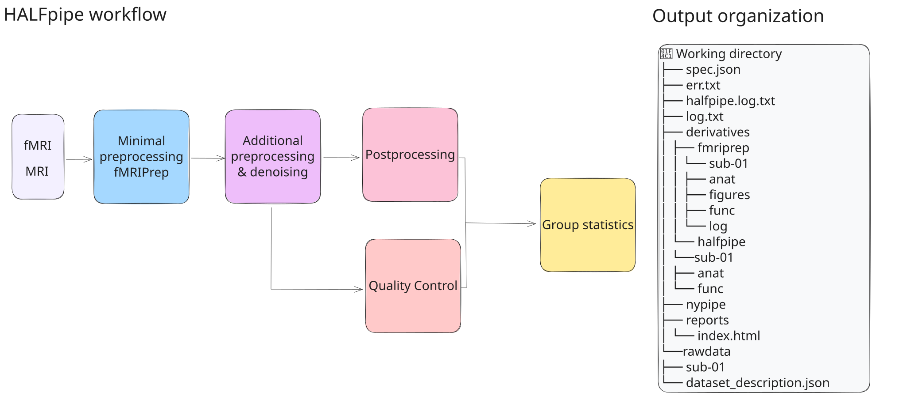

# Welcome to ENIGMA HALFpipe!

 
 

HALFpipe preprocesses fMRI data and runs analyses at the individual and group levels. It uses [fMRIPrep](https://fmriprep.readthedocs.io/) for preprocessing and can calculate common resting-state and task-based fMRI features. You can start with [BIDS](https://bids-specification.readthedocs.io/en/stable/) data or specify your input files in HALFpipe.

## Where to start

::: {.start-grid}

::: {.start-card}
[1. Install HALFpipe](installation.qmd)

Choose a container platform and prepare your inputs.
:::

::: {.start-card}
[2. Configure resting-state analysis](configure.qmd)

Choose an interface and set up preprocessing and feature extraction.
:::

::: {.start-card}
[3. Run and check outputs](check_run.qmd)

Launch the pipeline and check for missing outputs.
:::

::: {.start-card}
[4. Review output quality](quality-control.qmd)

Open the QC reports, rate the images, and export your ratings.
:::

:::

## Connectivity and group analysis

- [5. Check functional connectivity with WonkyConn](wonkyconn_docs.qmd) to review connectivity outputs.
- [6. Run ENIGMA-AN group-level analysis](group-level.qmd) once your derivatives and QC ratings are ready.

`HALFpipe` relies on tools from well-established neuroimaging software packages, either directly or through our dependencies, including [ANTs](https://antspy.readthedocs.io/), [FreeSurfer](https://surfer.nmr.mgh.harvard.edu/),  [FSL](http://fsl.fmrib.ox.ac.uk/), [AFNI](https://afni.nimh.nih.gov/>) and [nipype](https://nipype.readthedocs.io/>).
We strongly urge users to acknowledge these tools when publishing results obtained with HALFpipe.

Subscribe to our [mailing list](https://mailman.charite.de/mailman/listinfo/halfpipe-announcements) to stay up to date with new developments and releases.

If you get stuck, check [7. Troubleshooting](troubleshooting.qmd) or search the [HALFpipe issue tracker](https://github.com/HALFpipe/HALFpipe/issues).

