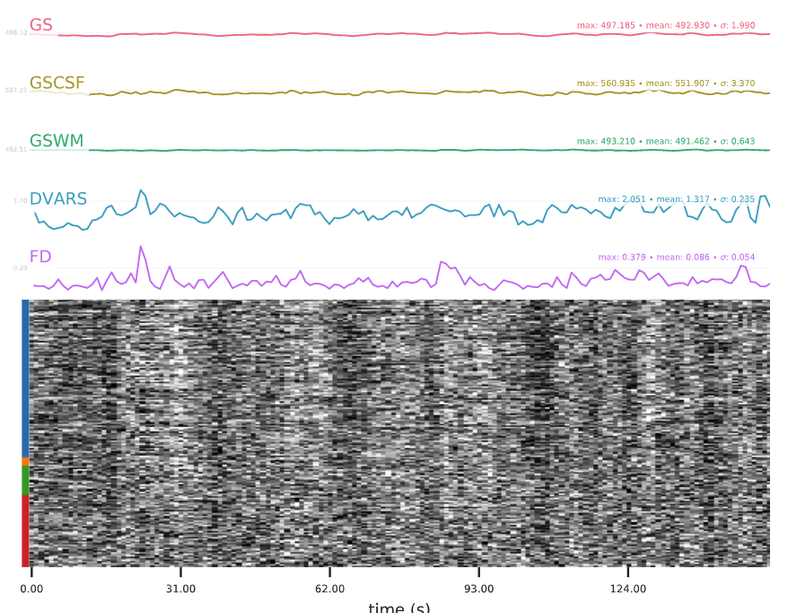
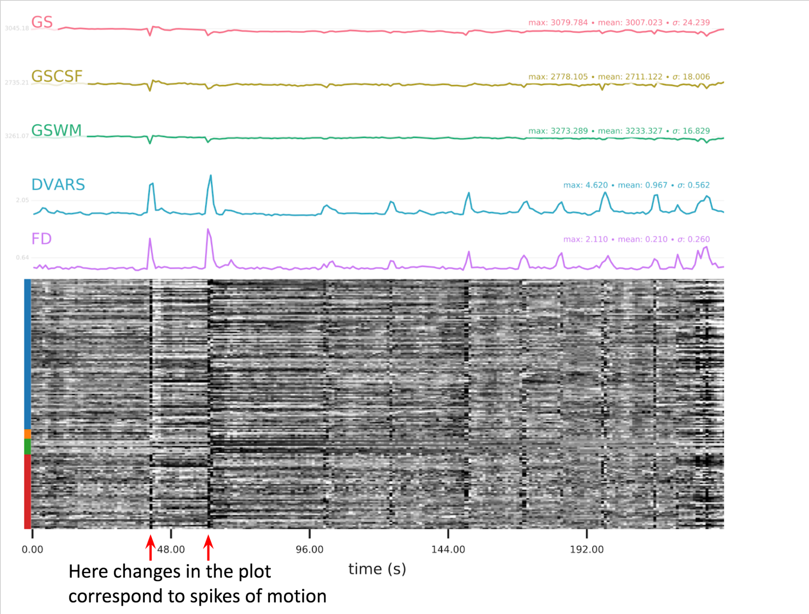
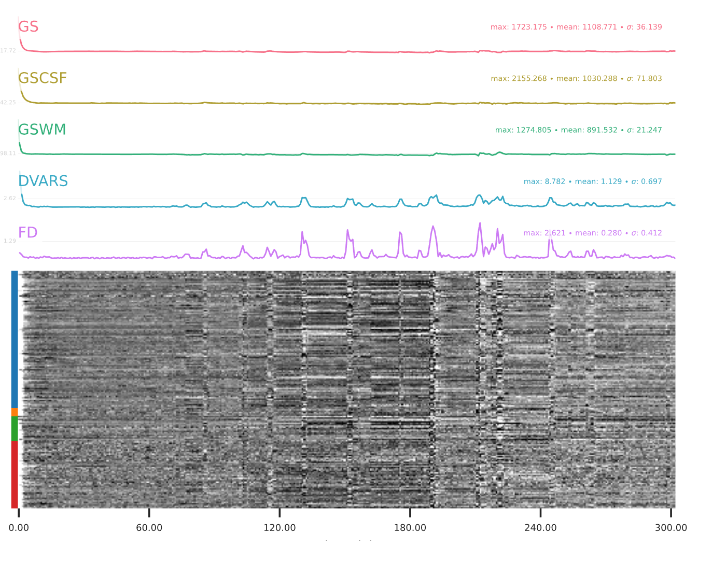
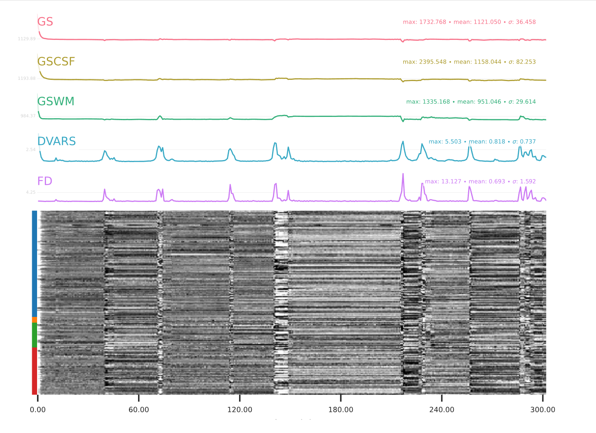
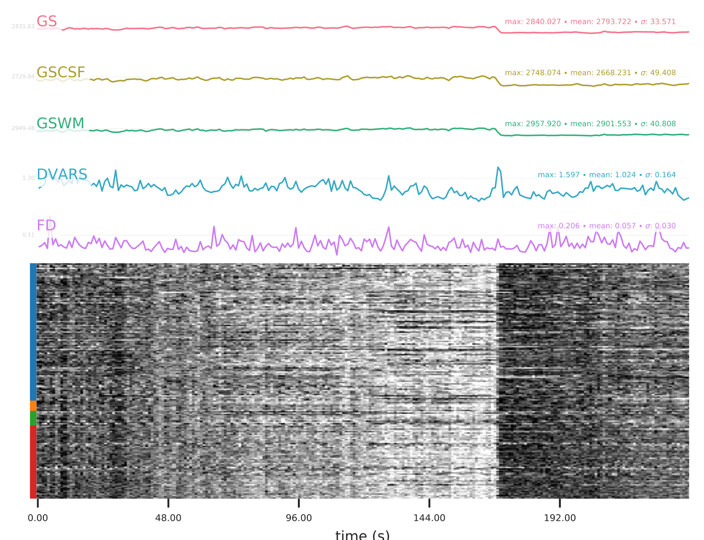
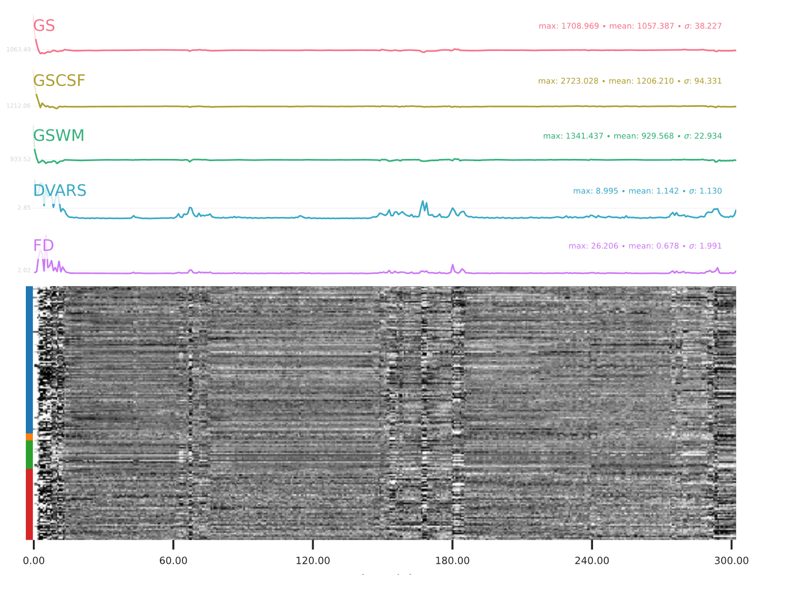

::: {.qc-page-tools}
[All report types](reports.qmd#examples-by-report-type){.btn .btn-outline-secondary .btn-sm}
[Back to rating](reports.qmd#explore-reports){.btn .btn-outline-secondary .btn-sm}
[Cheat Sheet](cheat-sheet.qmd){.btn .btn-outline-secondary .btn-sm}
[Examples](#example-of-a-good-subject-3){.btn .btn-outline-secondary .btn-sm}
[Summary](#summary-3){.btn .btn-outline-secondary .btn-sm}
:::

<!-- qc-source-start -->
Read the carpet plot from left to right. The horizontal axis shows time, and each row shows the signal from one voxel. The colour strip groups voxels by tissue or region: cortical grey matter (blue), subcortical grey matter (orange), cerebellum (green), and white matter and cerebrospinal fluid (red).

Look for sudden changes in the heatmap. Compare them with the framewise displacement (FD) and global signal (GS) traces above the plot. FD measures motion between successive frames. Changes that do not line up with motion may reflect other causes, such as hardware artefacts or changes in breathing.

## **Example of a good subject**  {#example-of-a-good-subject-3}

- No changes in the heatmap, low motion (FD mean < 0.5), no sudden large jumps in the FD line or GS
- Small changes in the heatmap identifiable as caused by motion or other causes (i.e., corresponding to changes in the graphs above the heatmap)

::: {.qc-example-gallery}

{group="good-epi_confounds"}

:::

## **Example of an uncertain subject**  {#example-of-an-uncertain-subject}

::: {.qc-example-gallery}

{group="good-epi_confounds"}

{group="good-epi_confounds"}

:::

## **Example of a bad subject**  {#example-of-a-bad-subject-3}

- Large changes in the heatmap can be indicative of motion. If this is the case, they will usually correspond to changes in the FD line (purple line) above the heatmap. Mean FD and max FD are also reported in the plot for each subject

::: {.callout-important collapse="false"}
- For group analysis, there will be the option to automatically exclude subjects with mean FD > 0.5, so you don’t have to check the mean FD for all subjects at this stage (but it could be helpful to look at FD values if you are unsure about whether to exclude or not a subject). Although we have not included a hard threshold for max FD, values > 3mm could be indicative of a problematic subject (i.e., with sudden jumps). In data sets with a high percentage of high motion individuals, it is worth considering whether the threshold should be raised to >3.5mm, in order to include a larger percentage of subjects.
- Changes in the heatmap without clear causes may indicate other artefacts, such as hardware-related artefacts. Other sudden changes could be related to respiratory patterns
:::

::: {.callout-tip collapse="false"}
- If you think that the carpet plot shows artefacts or other problematic issues, check the other quality metrics for that subject to decide whether they should be excluded
:::

::: {.qc-example-gallery}

{group="good-epi_confounds"}

{group="good-epi_confounds"}

{group="good-epi_confounds"}

{group="good-epi_confounds"}

{group="good-epi_confounds"}

:::

## **Summary** {#summary-3}

| **good** | **bad** |
|---|---|
| No changes in the heatmap | Big changes:  - could be related to motion  (change in the FD-line) |
| Small changes in the heatmap caused by motion mean FD < 0.5 | Mean FD > 0.5 or maximum FD > 3 mm |
| DVARS and FD “similar” |  |
| No big spikes |  |
: Table summary for wEPI confounds (carpet plot) {.striped .hover}
<!-- qc-source-end -->
