::: {.qc-page-tools}
[All report types](reports.qmd#examples-by-report-type){.btn .btn-outline-secondary .btn-sm}
[Back to rating](reports.qmd#explore-reports){.btn .btn-outline-secondary .btn-sm}
[Cheat Sheet](cheat-sheet.qmd){.btn .btn-outline-secondary .btn-sm}
[Examples](#example-of-a-good-subject-5){.btn .btn-outline-secondary .btn-sm}
[Summary](#summary-5){.btn .btn-outline-secondary .btn-sm}
:::

<!-- qc-source-start -->
This report shows how the EPI functional image aligns to the MNI template. Compare corresponding brain structures in the two images.

## **Example of a good subject**  {#example-of-a-good-subject-5}

- If the registration performed well, you should see an overlap (i.e., correspondence of structures) between the MNI template and the EPI registered to the MNI space.
- If parts of the brain are missing due to the scanner field of view, this is fine. For example, the cerebellum may be cut off for a participant with a large head.

::: {.qc-example-gallery}

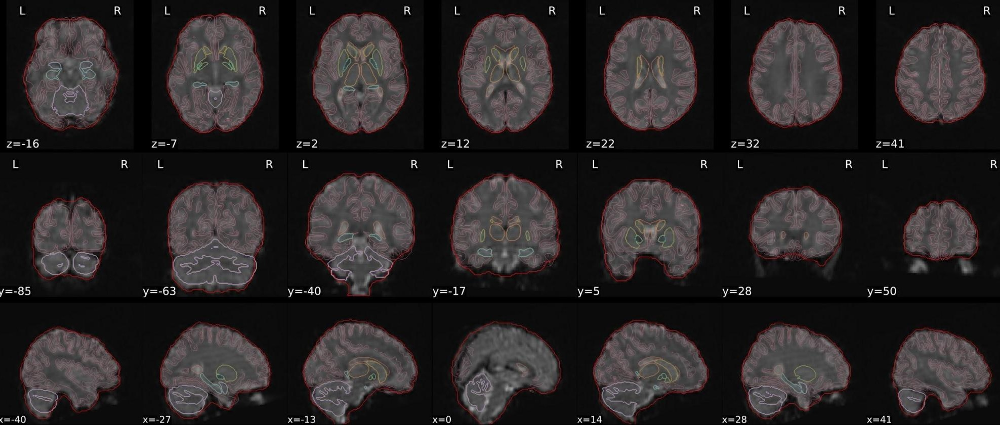{group="good-epi_spatial_normalisation"}

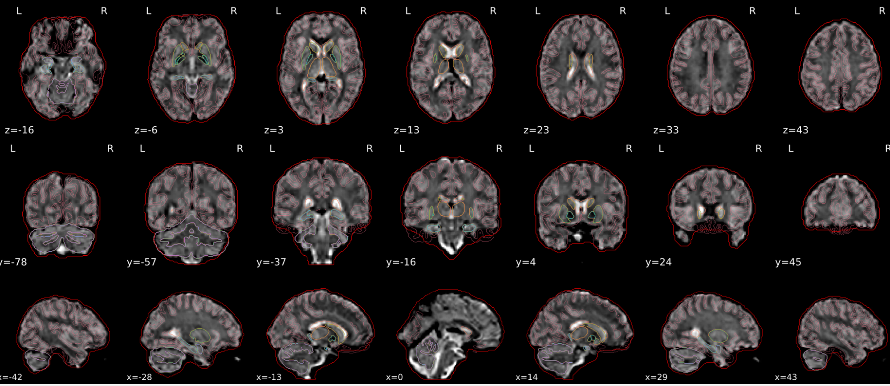{group="good-epi_spatial_normalisation"}

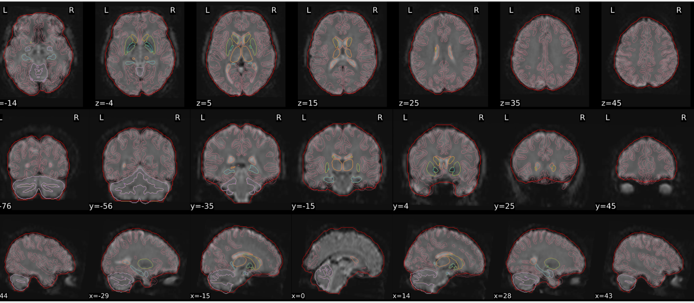{group="good-epi_spatial_normalisation"}

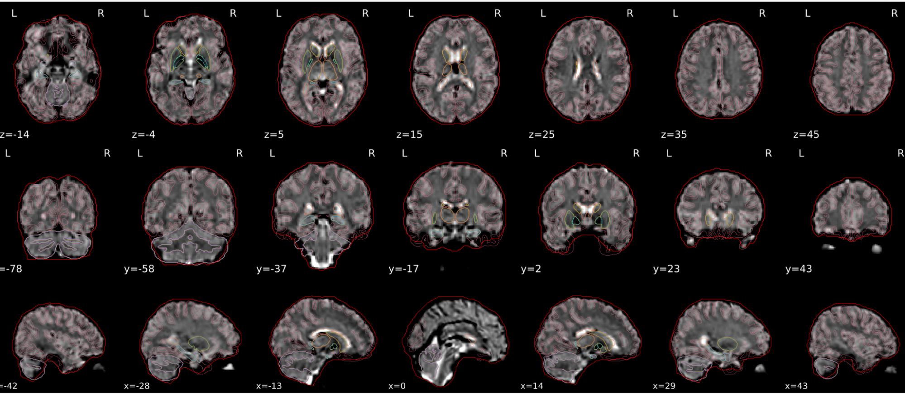{group="good-epi_spatial_normalisation"}

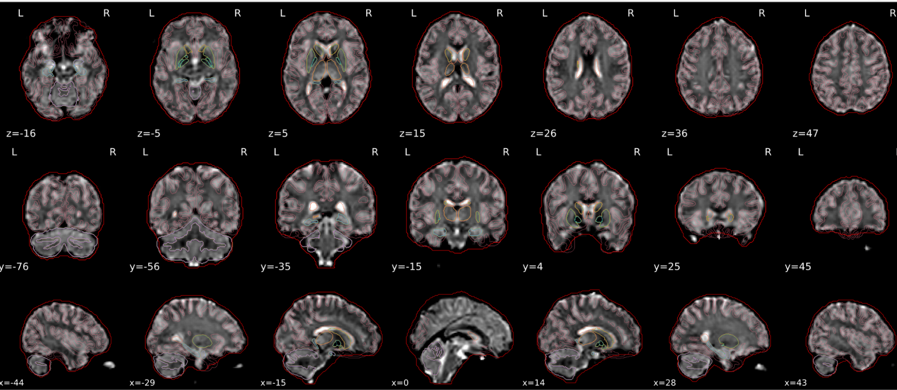{group="good-epi_spatial_normalisation"}

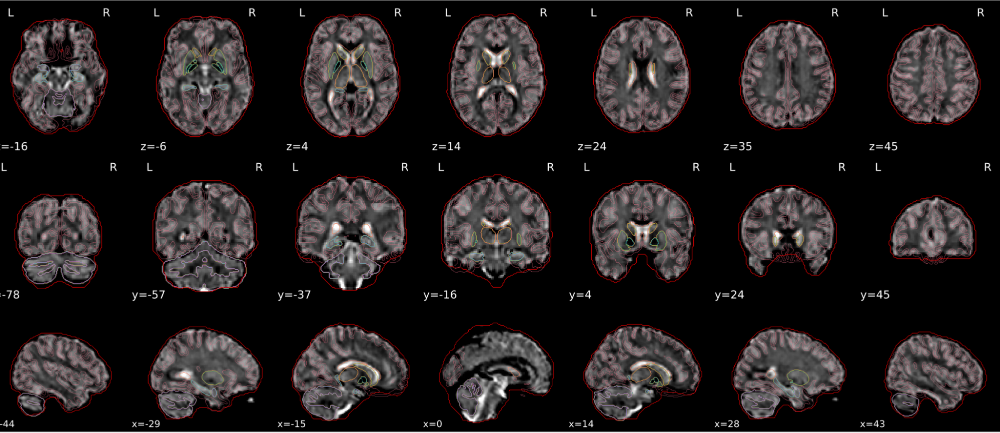{group="good-epi_spatial_normalisation"}

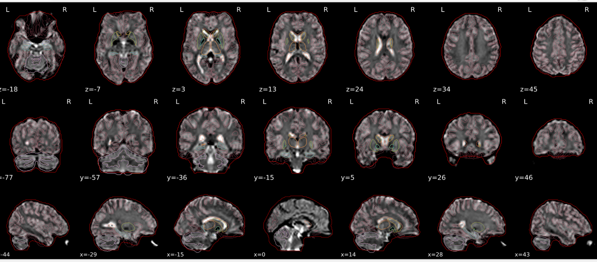{group="good-epi_spatial_normalisation"}

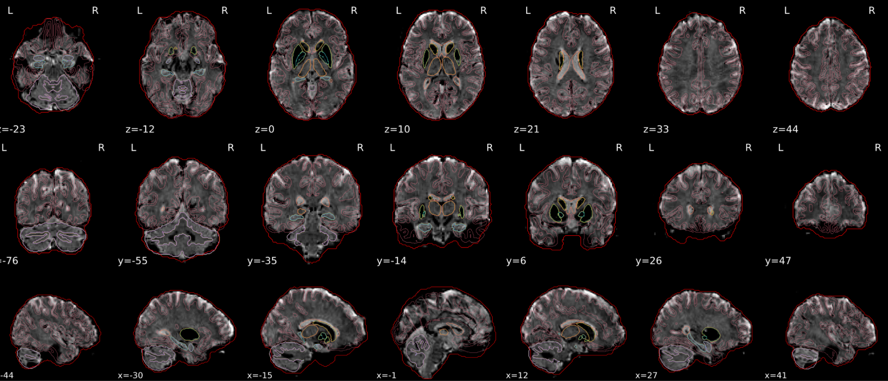{group="good-epi_spatial_normalisation"}

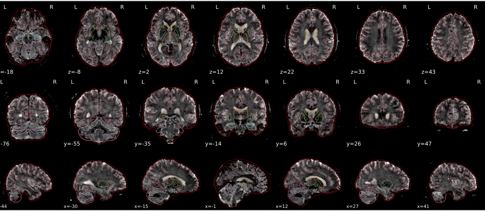{group="good-epi_spatial_normalisation"}

:::

## **Example of a bad subject**  {#example-of-a-bad-subject-5}

- In case of poor registration, you should see a misalignment of the EPI and the MNI template

::: {.qc-example-gallery}

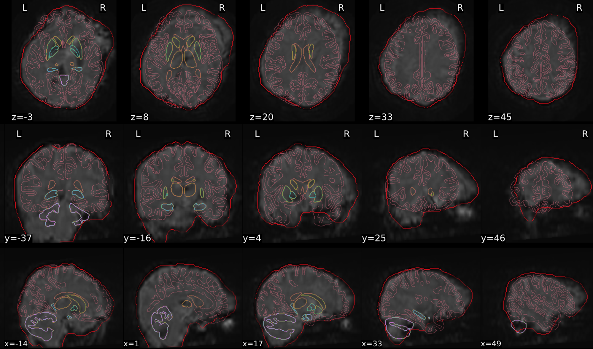{group="bad-epi_spatial_normalisation"}

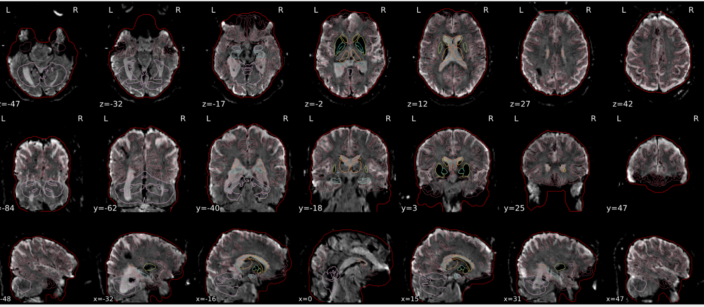{group="bad-epi_spatial_normalisation"}

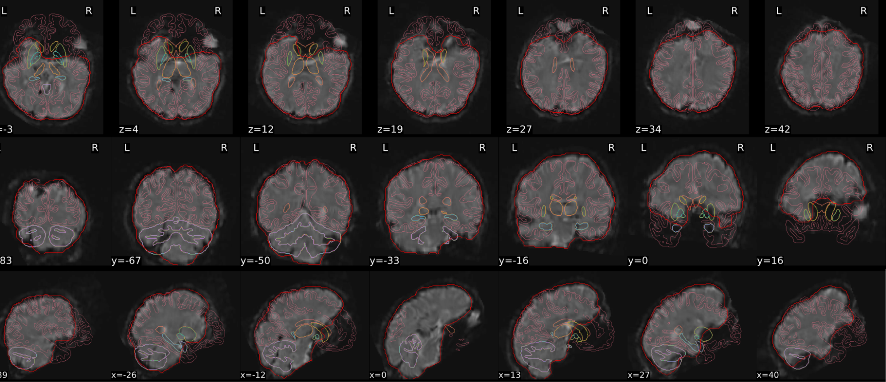{group="bad-epi_spatial_normalisation"}

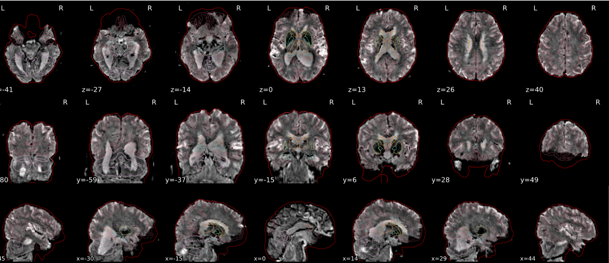{group="bad-epi_spatial_normalisation"}

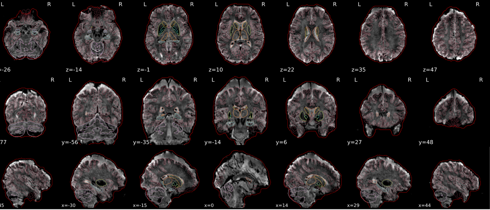{group="bad-epi_spatial_normalisation"}

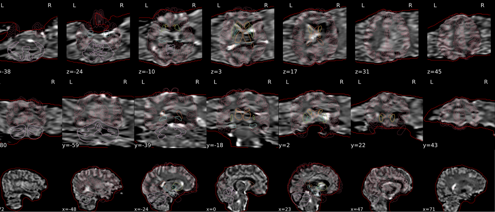{group="bad-epi_spatial_normalisation"}

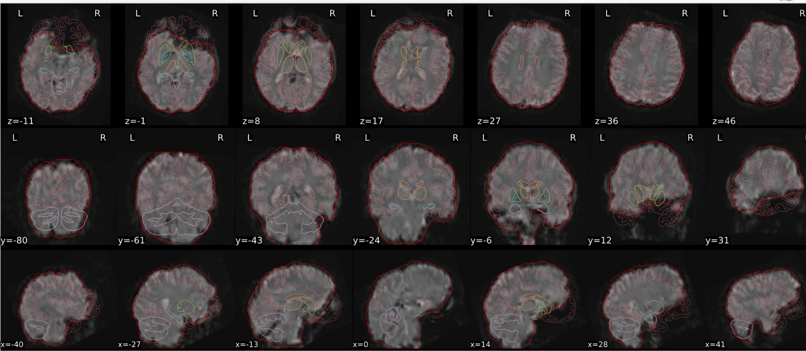{group="bad-epi_spatial_normalisation"}

:::

## **Summary** {#summary-5}

| **good** | **bad** |
|---|---|
| Overlap (i.e. match of structures) between the MNI template and the EPI registered in the MNI space | Misalignment of the EPI and the MNI template |
| If parts of the brain are missing because the field of view of the scanner is limited, the EPI spatial normalisation does not have to be excluded  *e.g. cerebellum cut off in person with large head* |  |

:::{.callout-important collapse="false" title="Part of the brain missing"}
If parts of the brain are missing because the field of view of the scanner is limited, the EPI spatial normalisation does not have to be excluded (e.g. cerebellum cut off in person with large head)
:::
<!-- qc-source-end -->
