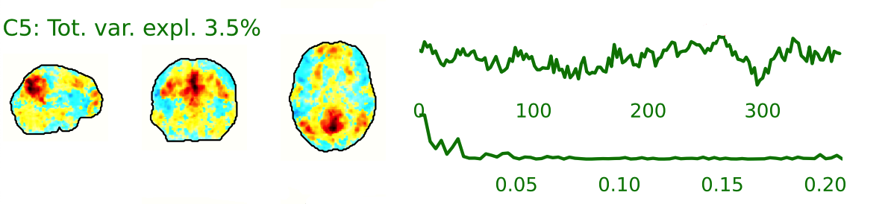
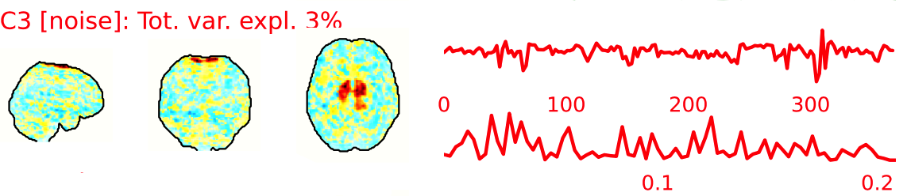
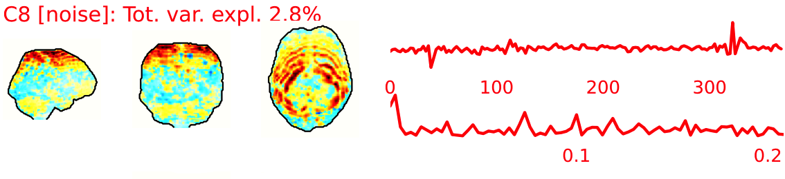
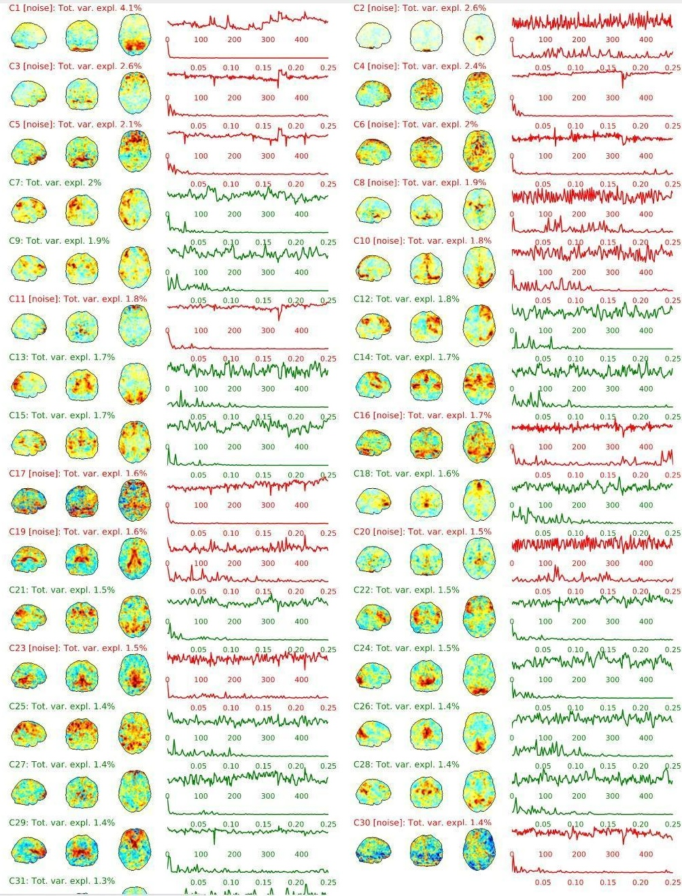

::: {.qc-page-tools}
[All report types](reports.qmd#examples-by-report-type){.btn .btn-outline-secondary .btn-sm}
[Back to rating](reports.qmd#explore-reports){.btn .btn-outline-secondary .btn-sm}
[Cheat Sheet](cheat-sheet.qmd){.btn .btn-outline-secondary .btn-sm}
[Examples](#example-of-a-good-subject-4){.btn .btn-outline-secondary .btn-sm}
[Summary](#summary-4){.btn .btn-outline-secondary .btn-sm}
:::

<!-- qc-source-start -->
HALFpipe can generate an ICA-AROMA QC panel even when your selected denoising pipelines do not use ICA-AROMA. In versions 1.3.1 and 1.3.2, the global `run_aroma` setting controls whether HALFpipe computes the components by default. Each pipeline has a separate `ica_aroma` setting for whether it uses those components for denoising.

The five denoising pipelines in the current ENIGMA resting-state workflow do not use ICA-AROMA. For the main review sequence, see [all report types](reports.qmd#examples-by-report-type).

The fMRI data for each subject are decomposed into spatially independent components. Each component is represented by a spatial map and a time course. Some components represent noise, some signal. ICA AROMA is trained to automatically classify these components. Signal components are usually represented by **low numbers of large clusters** (some of which may represent known networks such as the Default Mode Network), located in the **GM and away from WM, CSF, blood vessels,** or the edges of the brain. Signal components usually do not have a particular shape, while noise components may show banding or ring patterns. Signal components usually have low frequency (0.01-0.1 Hz) (i.e., few spikes on the left hand side of the power spectra plot), **while noise high frequency**, or very low. The time series of signal components is oscillatory and fairly regular, while in noise we may see sudden spikes or differing patterns (see Griffanti et al., 2017. Hand classification of fMRI ICA noise components. NeuroImage).

Some examples are presented below. For each component, there is a spatial map (on the left), the time series (top plot on the right) and the power spectra (bottom plot on the right). Of note, ICA AROMA errors cannot be 'fixed', as it automatically classifies the components.

::: {.callout-important collapse="false"}
We don't expect you to check all the components for every subject. Rather, try to eyeball the report and see whether generally clusters that should be signal (according to the description above) are coloured in green. If you think that ICA AROMA performed poorly, check the other quality metrics for that subject to decide whether they should be excluded.
:::

::: {.qc-example-gallery}

{group="epi_ica"}

{group="epi_ica"}

{group="epi_ica"}

:::

## **Example of a good subject**  {#example-of-a-good-subject-4}

- Components correctly classified in noise (red) and signal (green), conservative classification (uncertain components classified as signal).

::: {.qc-example-gallery}

{group="good-epi_ica"}

:::

## **Example of a bad subject**  {#example-of-a-bad-subject-4}

- ICA AROMA might have performed poorly if it classified all/most of the components as noise, when some of them could have been signal. These types of errors are more likely to occur in task fMRI with block designs, whereby some task-related activity may be classified as motion. In resting state, try to look for common large brain networks such as the default mode network/salience network. If they have been classified as noise, ICA-AROMA might have not performed well. It is possible that ICA AROMA classified all/most of the components as noise if the subject was particularly problematic (lot of motion, artefacts)
- Components that look like rings, bandings or stripes are usually acquisition-related artefacts (e.g., interleaved acquisition, multi-band). The presence of these artefacts is not an issue by itself, but ideally these components should be classified as noise. Note that ICA AROMA was not trained on multiband data, so it is possible that it classifies some of these components as signal (nothing we can do about).
- **We don't expect you to check all the components for every subject. Rather, try to eyeball the report to get a general idea. If unsure, and there is a recurring issue across youdr dataset, please send us some screenshots.**
- In case of uncertain components, it is preferable that ICA AROMA behaved conservatively, and did not remove these components, because they may contain some signal

::: {.callout-tip collapse="false"}
**NOTE:** If you think that ICA AROMA performed poorly or the subject looks problematic, check the other quality metrics for that subject to decide whether they should be excluded.
:::

::: {.qc-example-gallery}

{group="bad-epi_ica"}

:::

## **Summary** {#summary-4}

| **good** | **bad** |
|---|---|
| Time series (at the top): no sudden jumps power (bottom) | More noise (red) than signal (green):  - Occurs more often with block design  - or “problematic” subject (lots of movement, lots of artefacts) rings, bands, artefacts  - should be classified as noise |
| Spatial patterns are visible |  |
| No sudden jumps/spikes |  |
| No big spikes |  |
: Table summary for EPI ICA-based artefact removal (carpet plot) {.striped .hover}
<!-- qc-source-end -->
