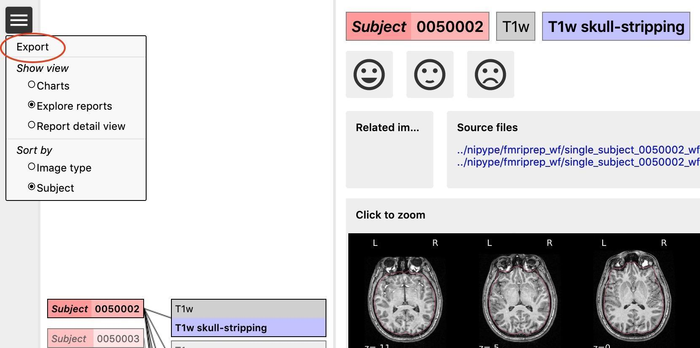
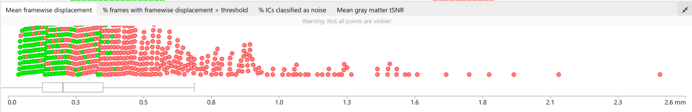

::: {.qc-page-tools}
[Quality control](../quality-control.qmd){.btn .btn-outline-secondary .btn-sm}
[Cheat Sheet](cheat-sheet.qmd){.btn .btn-outline-secondary .btn-sm}
:::

<!-- qc-source-start -->
If you decide to rerun a subject after QC, follow the [HALFpipe rerun instructions](../check_run.qmd#rerun-halfpipe). [Check that the rerun completed](../check_run.qmd#check-preprocessing-outputs), then [review the updated images and update their ratings](reports.qmd#explore-reports).

If there are no subjects to rerun, or you've finished reviewing the updated outputs, [export your ratings](#export-your-qc-ratings).

## Export your QC ratings {#export-your-qc-ratings}

Before exporting, revisit subjects flagged for high mean framewise displacement (FD) and check the relevant ratings and exclusion decisions.

1. Return to `reports/index.html`.
2. Open the menu in the upper left and select **Export**. Your browser downloads `exclude.json`.
3. Keep that file with your QC records. Export again if you change any ratings.

For group analysis with HALFpipe, supply the saved file as described in [6. Run group-level analysis (ENIGMA-AN)](../group-level.qmd). HALFpipe uses the supplied ratings to skip scans marked bad. See that guide for how to pass the file and specify any separate motion cutoffs.
<!-- qc-source-end -->
