::: {.qc-page-tools}
[All report types](reports.qmd#examples-by-report-type){.btn .btn-outline-secondary .btn-sm}
[Back to rating](reports.qmd#explore-reports){.btn .btn-outline-secondary .btn-sm}
[Cheat Sheet](cheat-sheet.qmd){.btn .btn-outline-secondary .btn-sm}
[Examples](#example-of-a-good-subject-1){.btn .btn-outline-secondary .btn-sm}
[Summary](#summary-1){.btn .btn-outline-secondary .btn-sm}
:::

<!-- qc-source-start -->
This report shows how the T1 anatomical image aligns to the MNI reference space. The registered T1 image is the background. Compare its anatomy with the brain atlas overlaid on top.

## **Example of a good subject**  {#example-of-a-good-subject-1}

- If the registration performed well, you should see an overlap (i.e., correspondence of structures) between the MNI template and the T1 registered to the MNI space.

::: {.qc-example-gallery}

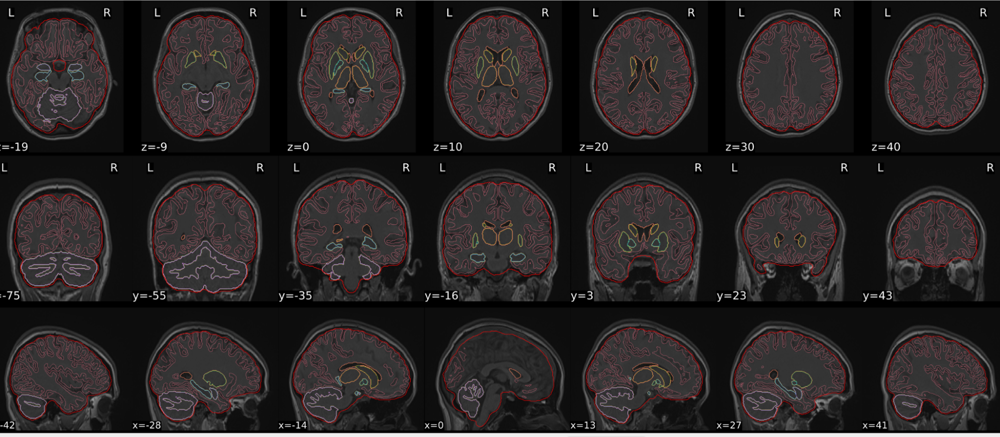{group="good-dt1w-spatial-normalisation"}

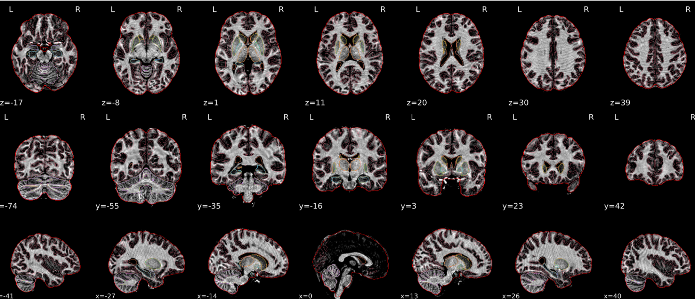{group="good-dt1w-spatial-normalisation"}

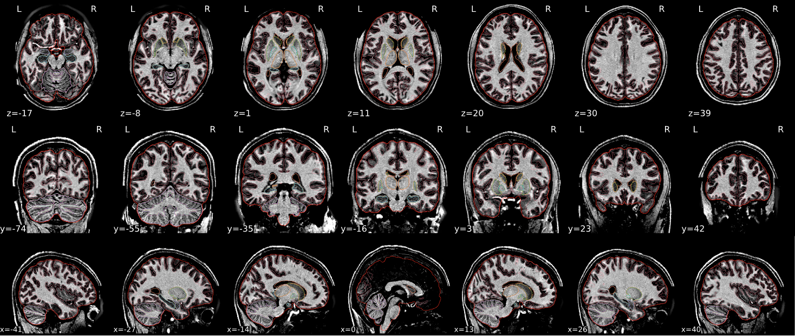{group="good-dt1w-spatial-normalisation"}

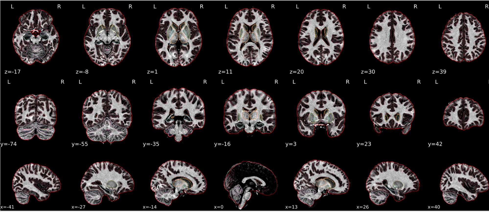{group="good-dt1w-spatial-normalisation"}

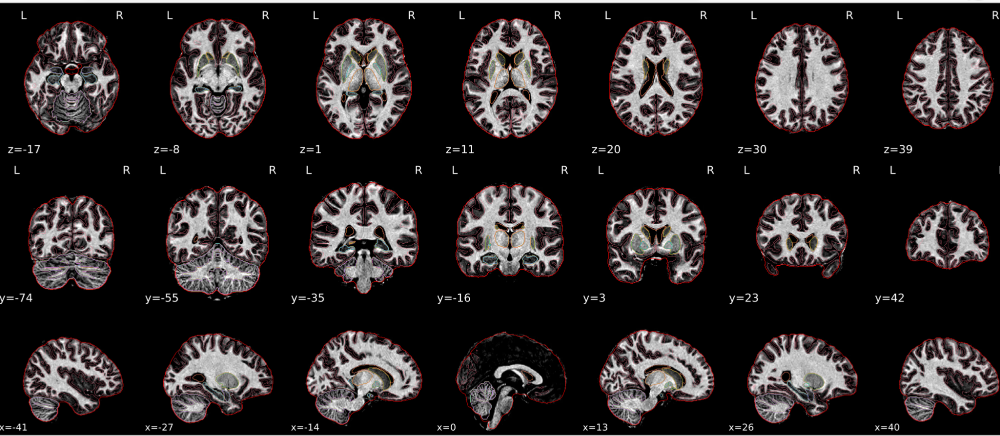{group="good-dt1w-spatial-normalisation"}

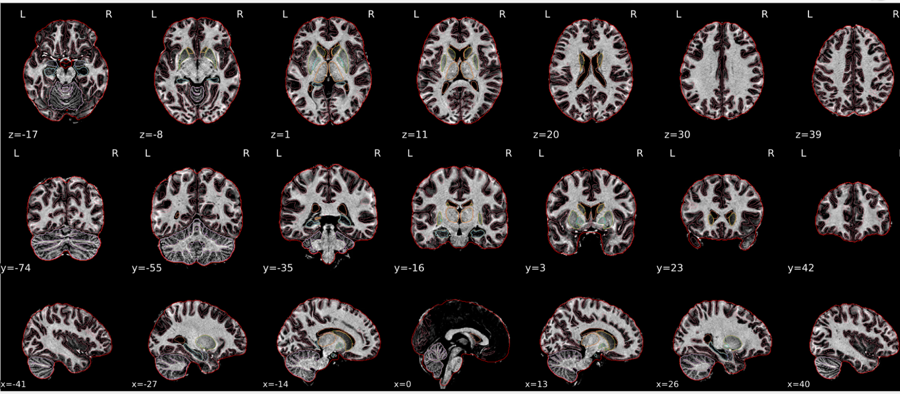{group="good-dt1w-spatial-normalisation"}

:::

## **Example of a bad subject**  {#example-of-a-bad-subject-1}

- In case of poor registration, you should see a misalignment between the MNI template and the T1 (e.g., brain shifted down).

::: {.qc-example-gallery}

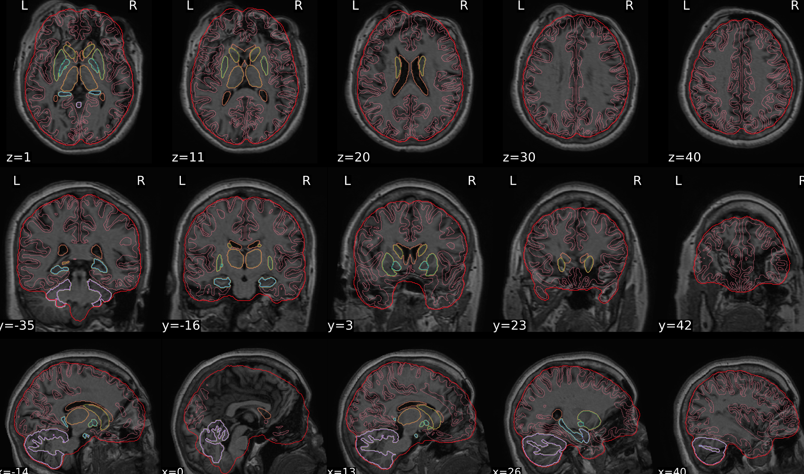{group="bad-dt1w-spatial-normalisation"}

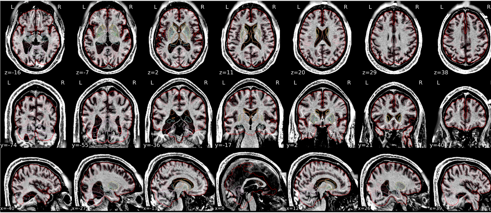{group="bad-dt1w-spatial-normalisation"}

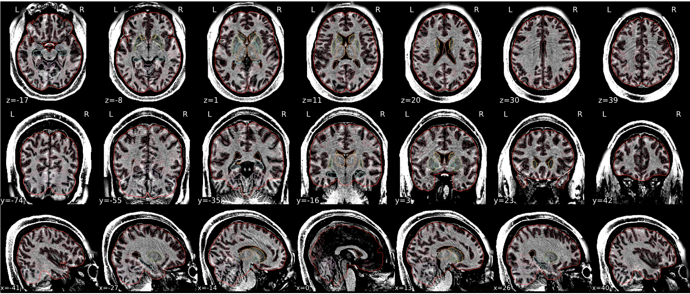{group="bad-dt1w-spatial-normalisation"}

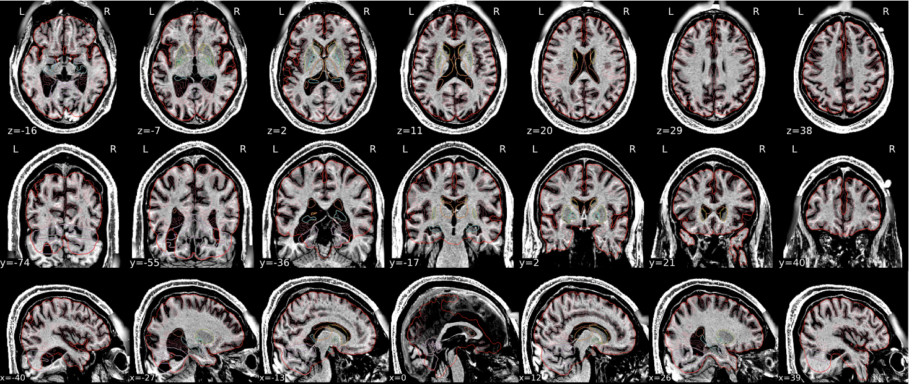{group="bad-dt1w-spatial-normalisation"}

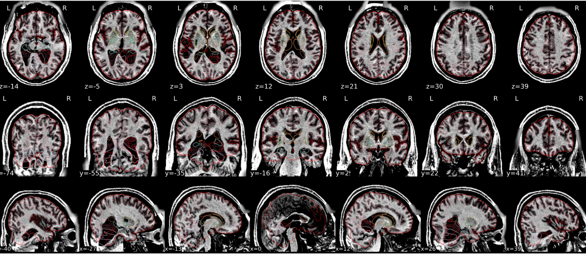{group="bad-dt1w-spatial-normalisation"}

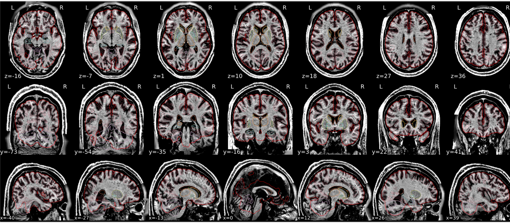{group="bad-dt1w-spatial-normalisation"}

:::

## **Summary** {#summary-1}

| **good** | **bad** |
|---|---|
| Structures of the MNI template and the registered T1 are well aligned | Structures of the MNI template and the registered T1 aren't well aligned,  *e.g. brain is shifted downwards* |
: Table summary for dT1w spatial normalisation {.striped .hover}
<!-- qc-source-end -->
